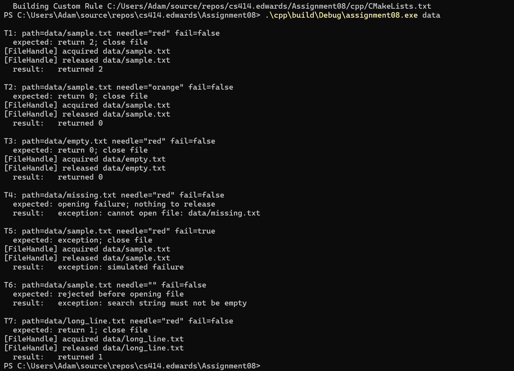

# Assignment 08: RAII, Resource Safety, and Side Effects

**Author:** Adam Edwards  

**Course:** CS 414 – Dr. Lewis  

**Date:** 11/15/2026

## AI Use

I used Claude (Anthropic) to help draft the C++ and OCaml programs, test drivers, comments, and initial report. I reviewed the code, simplified the comments, and revised the report with ChatGPT. AI assistance is also documented in the source file headers. 

## Files and Build Instructions

```text

Assignment08/

  cpp/       file_handle.hpp, file_handle.cpp, main.cpp, CMakeLists.txt

  ocaml/     dune-project, dune, main.ml

  data/      sample.txt, empty.txt, long_line.txt

  docs/      cpp_results.png, ocaml_results.png

  REPORT.md

```

The programs take the data folder as an argument rather than using a fixed path. `missing.txt` is intentionally absent for T4. `long_line.txt` contains a line longer than the C++ buffer for T7.

**C++** — from the `Assignment08` folder in Developer PowerShell:

```powershell

cmake -S cpp -B cpp/build

cmake --build cpp/build

.\cpp\build\Debug\assignment08.exe data

```

**OCaml** — from the `Assignment08\ocaml` folder with the opam environment loaded:

```powershell

dune build

dune exec ./main.exe -- ..\data

```

The programs print results and show when files are opened and closed. Screenshots of T1–T7 are in `docs/`. These messages show that the cleanup code ran; they do not independently prove that the operating system released the handles.

## Part A – C++

### A1. Which paths in `count_matches_bad` close the file?

If `fopen` fails, no file was opened, so there is nothing to close. If the function finishes normally, it reaches `fclose` and closes the file. If an exception happens after opening the file, the function skips `fclose`, leaving the file open. This includes the simulated failure.

The original `fgets` loop also has a problem with long lines. It can treat one long line as several lines because the buffer only holds part of it at a time.

### A2/A3. What I built

I created `FileHandle` to manage the `FILE*` using RAII. Its constructor opens the file, and its destructor closes it. Copying and moving are disabled so the handle has one owner. The `get()` function lets the counting function read the file without owning it.

`count_matches_cpp` checks for an empty search string before opening the file. It then uses `FileHandle` and counts the lines containing the search string. I added `read_line` to combine buffer chunks so long lines are counted correctly.

### A4. Questions

**1. When does C++ call `FileHandle::~FileHandle()`?**

The destructor runs when the `FileHandle` object goes out of scope, whether the function returns normally or an exception causes stack unwinding. In T5, the file is released before the test driver catches the exception. If opening fails in the constructor, the object was never fully created, so its destructor does not run.

**2. Why is an object with a destructor safer than the raw `FILE*` code?**

With a raw pointer, I have to remember to call `fclose` on every path. With RAII, the destructor handles cleanup automatically when the object leaves scope, including during exceptions.

**3. Why is copying a resource-owning handle dangerous? What changes with moves or `std::unique_ptr`?**

Copying the pointer would give two objects the same file handle. Both could try to close it, causing undefined behavior. A move transfers ownership instead of copying it. `std::unique_ptr` also supports single ownership and can use a custom deleter to close a file. I disabled moves because this program does not need them.

**4. Does RAII prevent the file from being opened, or prevent the read from affecting external state?**

No. Opening, reading, and closing the file still have side effects. RAII just manages when the resource is released. It doesn't make the operations pure.

## Part B – OCaml

### B1. The unsafe pattern

In `count_matches_bad`, `close_in` only runs if the counting loop finishes normally. `End_of_file` is caught inside the loop and returns the count, allowing the file to close. Other exceptions are not caught and leave the function before `close_in` runs. This can leave the file open.

### B2. `with_input_file` and its behavior

```ocaml

let with_input_file path f =

  let ch = open_in path in

  Fun.protect

    ~finally:(fun () ->

      close_in_noerr ch;

      prerr_endline ("[with_input_file] closed " ^ path))

    (fun () ->

      prerr_endline ("[with_input_file] opened " ^ path);

      f ch)

```

`open_in` opens the file first. If it fails, there is nothing to close. After a successful open, `Fun.protect` makes sure the cleanup runs whether `f` finishes normally or raises an exception. The original exception still reaches the caller. I used `close_in_noerr` so an error while closing does not replace the original exception.

The callback should only use the channel while `with_input_file` is running, since the channel is closed afterward. OCaml does not prevent a callback from saving the channel for later use, so that rule has to be followed by the programmer.

`count_matches_ocaml` checks for an empty search string before opening the file. It reads each line with `input_line` and uses `contains_substring` to check for the search text. The optional failure argument is used for T5. The final `()` allows the optional argument to be omitted.

### B4. Cleanup and side effects

**Why can't the garbage collector be relied on to close a file promptly?**

The garbage collector manages memory, and there is no guarantee it will run when a file is no longer needed. File handles should be closed when the program is done using them, not left for garbage collection.

**How is `Fun.protect` like `try ... finally`?**

It runs the cleanup function whether the protected code succeeds or raises an exception. The exception still passes back to the caller.

**How does it differ from a C++ destructor?**

C++ connects cleanup to an object's lifetime. OCaml uses `Fun.protect` around the code that uses the resource. Both can guarantee cleanup, but in OCaml I have to make sure the file is opened through the protected helper.

## Part C – Test Results (T1–T7)


| Test | Expected behavior | C++ result | OCaml result | Cleanup |
|---|---|---|---|---|
| T1: `red` in `sample.txt` | Return 2 | 2 | 2 | Both close file |
| T2: `orange` in `sample.txt` | Return 0 | 0 | 0 | Both close file |
| T3: empty file | Return 0 | 0 | 0 | Both close file |
| T4: missing file | Opening error | `runtime_error` | `Sys_error` | Nothing opened |
| T5: forced failure | Raise/throw error | `runtime_error` | `Failure` | Both close before error is reported |
| T6: empty search string | Reject before opening | `invalid_argument` | `Invalid_argument` | Nothing opened |
| T7: long line | Return 1 | 1 | 1 | Both close file |


All seven tests produced the expected results in both programs. T5 is the main resource-safety test: the close/release message appears before the test driver reports the exception. T7 shows that the C++ line reader handles a line longer than its buffer.

## Synthesis

**Which operations have side effects? Do the returned counts describe all of them?**

Opening, reading, and closing a file have side effects. The log messages also write output. The returned count only tells me how many lines matched, not everything the program did to get that result.

**In what sense does RAII encapsulate an effect rather than eliminate it?**

RAII doesn't remove the side effects. It keeps opening and closing the file tied to the `FileHandle` object's lifetime, so cleanup is handled in one place.

**Compare a C++ destructor at scope exit with an OCaml `finally` callback. What assumptions does each language make?**

Both perform cleanup during normal completion and exception handling. In C++, the resource needs to belong to an object whose destructor releases it safely. In OCaml, the resource needs to be used inside `Fun.protect`, and the callback should not keep using it after the protected function finishes.

**How do ownership and exception propagation affect correctness?**

There should be one clear owner responsible for closing a resource. Cleanup must also happen when an exception interrupts the program. Both programs let the error reach the caller while still releasing an opened file. This provides exception safety because the files are still released when an exception occurs, even though the operation did not finish.

**Why isn't garbage collection the same as deterministic cleanup?**

Garbage collection does not guarantee when unused memory is reclaimed. Deterministic cleanup releases the file at a known point: at scope exit in C++ or at the end of the protected operation in OCaml.

**Resource cleanup versus rollback**

Closing a resource does not undo actions that already happened. For example, closing a file after writing to it does not remove what was written. Cleanup releases the resource; rollback would need separate logic.

## Part D – OCaml Compositional Resource Handling (Option 2)

```ocaml

let with_two_input_files path1 path2 f =

  with_input_file path1 (fun ch1 ->

    with_input_file path2 (fun ch2 ->

      f ch1 ch2))

```

This uses two nested `with_input_file` calls. Each one handles its own cleanup. If the second file fails to open, the first file still closes. If both open successfully, they close in reverse order: file 2, then file 1.

| Test | Condition | Result | Cleanup order |
|---|---|---|---|
| D1 | Both files open | `(4, 1)` | File 2, then file 1 |
| D2 | Second file is missing | `Sys_error` | File 1 closes |
| D3 | Callback raises an exception | `Failure "simulated failure"` | File 2, then file 1 |

These tests show that nested protected operations clean up correctly, even when opening the second file or running the callback fails.

## Test Evidence

### C++ Test Results (T1-t7)
 

 ### OCaml Test Results (T1-T7 and D1-D3)
  